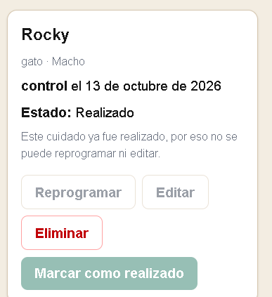
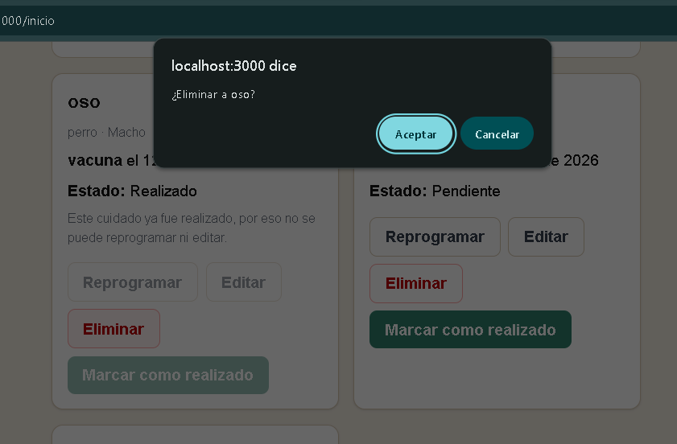

## 1 captura ##

## problema y consecuencia ##
cuando presionamos "marcar como realizado" se ejecuta sin confirmacion ni aviso y bloquea las acciones como editar y reprogramar sin poder revertirlo un click accidental y deja el registro bloqueado.

## heuristica ##
H5 - prevencion de errores

## severidad ##
3

## 2 captura ##

## problema y consecuencia ##
un cuidado pendiente y con la fecha pasada no se distingue con un cuidado con una fecha proxima haciendo dificil darse cuenta de que ya paso el cuidado y no reprogramo.

## heuristica ##
H1 visibilidad del estado 

## severidad ##
3

## 3 captura ##

## problema y consecuencia ##
al eliminar un cuidado  menciona el nombre de la mascota pero no su cuidado ni la fecha si hubiera dos cuidados de la misma mascota no se sabria cual esta eliminando y no avisa que es permanente.

## heuristica ##
H5 - prevencion de errores

## severidad ##
3